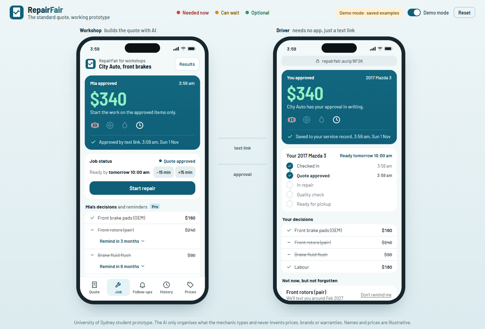
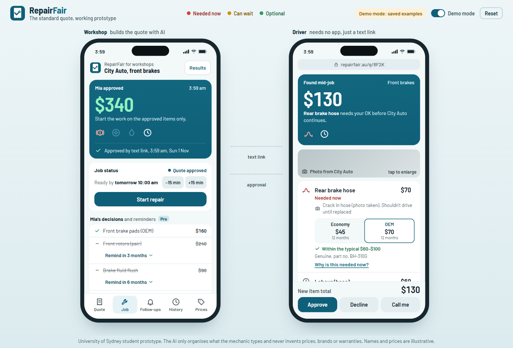
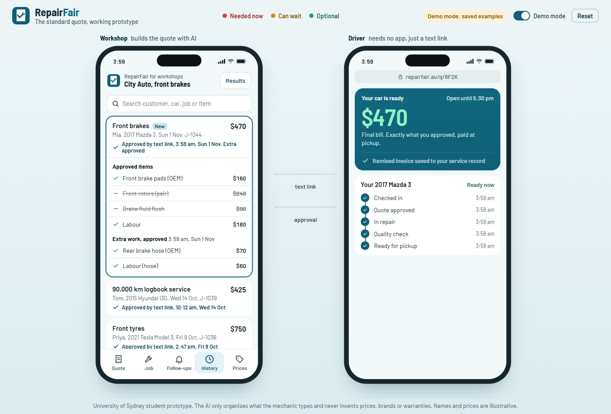

# RepairFair: the standard quote for car repairs

A working prototype from a seven-person startup team in **SIEN6007 Entrepreneurship: Lean Startup** at the
University of Sydney (Semester 2, 2026). The workshop turns a mechanic's rough notes into a clear, itemised quote
and sends it as a text link. The driver approves each item before work starts, including any extra work found
mid-job, and the final bill matches what was approved.



## The problem

We heard from drivers through a survey and interviews, and then interviewed independent workshops.

- Drivers can't check a repair quote at the moment they have to say yes, and almost nobody tries: 0 of 12 surveyed
  drivers and 1 of 13 interviewed drivers got a second quote.
- All 11 quotes we reviewed showed labour as one lump sum, with no hours or rate.
- 5 of 10 bills rose more than 10% after the first quote, mostly through a phone call mid-job. One front brake job
  quoted at $300 was billed at $1,120.
- Workshops have the same problem from the other side. One lost $60 when a customer denied approving brake fluid,
  and another said 10-15% of its jobs are disputed.

We started with a quote check for drivers. The research showed drivers rarely use one when the quote arrives, so we
moved to fixing the quote where it's written, with a product that workshops pay for and drivers use free. Of 10
workshops interviewed, 6 said they would trial it free and 4 said they would pay $29-79 a month. These are interview
answers, not sales.

## What the prototype does

**Workshop side**
- The mechanic records what the customer reported, and the AI can suggest 3 to 5 things to check. These are
  suggestions, not a diagnosis. They stay on the workshop phone and never reach the quote or the driver.
- The mechanic types rough notes ("Front pads at 2mm, need doing now (photo taken). Pad options: economy $90, OEM $160...") and the AI drafts a
  structured quote: parts and labour itemised, labour shown as hours times rate.
- Each item gets an urgency status: **needed now**, **can wait**, **optional** or **to confirm**, taken from the
  mechanic's own words.
- Parts can be offered in four quality tiers: Used, Economy, OEM and Premium.
- The AI only organises what the mechanic wrote. It is told never to invent prices, brands, part numbers or
  warranties, and anything missing is listed for the workshop to confirm before sending.
- **Mechanic check:** every gap must be fixed or marked to confirm later, and a "needed now" item needs a photo or
  measurement. Sending stays locked until the mechanic signs off.
- **Price book:** the workshop's own prices, brands and part numbers fill the gaps.
- Extra work found mid-job goes through the same flow and needs the driver's written approval.
- **Follow-ups:** work the driver says "not now" to becomes a timed reminder, with a link to book a time.
- **Results:** a screen showing what the workshop gained (sample figures).
- **Send to Xero:** a draft invoice preview and a CSV laid out for Xero's import. The send is a demo, and the file
  hasn't been tested in Xero.

**Driver side**
- Opens the quote from a text link, with no app to download.
- Switches items on or off one by one, and items left off become "not now" for later.
- Reads a plain-English reason for each item and a fair price check against typical ranges.
- Sees the job's progress and the estimated ready time.
- Every approval is timestamped and kept in a searchable job history.





## How it's built

- **Back end:** Python and Flask (`app.py`). The OpenAI API returns the quote as JSON, which the server checks and
  cleans up before the page sees it: unknown statuses become "to confirm", only the four part tiers are allowed,
  and labour price is worked out from hours and rate.
- **Front end:** plain JavaScript, HTML and CSS (`static/`), showing the workshop's phone and the driver's phone side
  by side.
- **API key:** read from a local `.env` file on the server and never sent to the browser.
- **Demo mode:** replays saved examples from `demo_data/`, so the demo works without internet or an API key.
- **Offline:** fonts (Barlow, SIL Open Font License) and the Motion animation library (MIT) are stored in
  `static/vendor/`.
- **Design:** each screen leads with a blue-teal "instrument panel" showing the number that matters and warning
  lights, above plain lists with normal phone controls. Colour only means urgency or state.
- Built with AI coding assistance (Claude Code).

For a plain-English guide to the setup, see [docs/how-it-works.md](docs/how-it-works.md).

## Run it locally

You need Python 3 installed.

```
pip install -r requirements.txt
python app.py
```

Then open http://localhost:5000 in Chrome or Edge. On Windows you can double-click `Start demo.bat` instead.

- **Without an API key:** tick **Demo mode** in the top right.
- **With your own OpenAI key:** copy `.env.example` to `.env`, paste your key after `OPENAI_API_KEY=`, and run
  `python check_ai.py` to check the model name works. Set a spending limit on your OpenAI account first.

**Demo flow:**
1. Workshop: under **Customer reported**, tap **Suggest what to check** and tick what you've looked at. These are for
   the mechanic only. Then tap **Build standard quote with AI**.
2. In the **Mechanic check**, fill the gaps from your price book, mark anything left **Resolved** or **Confirm later**,
   tick **I've checked this quote**, then **Send to Mia by text**. Any "needed now" item without a photo or measurement
   is flagged too. To show this, set Brake fluid flush to **Needed now**, then back to **Optional** before sending.
3. Driver: check the fair price line on each item, tap **Why is this needed now?** on the pads, pick a part option,
   and leave rotors and brake fluid switched off. Their lights stay dark in the panel at the top. Then
   **Approve selected items**. The approved total is $340.
4. Workshop: the app moves to the **Job** tab once Mia approves. Tap **Found something extra mid-job?**, then
   **Build extra item with AI**, resolve its check the same way, tick **I've checked this extra item**, then
   **Send to Mia for approval**.
5. Driver: **Approve**. Both phones show the final bill of $470, which matches what was approved.
6. Workshop: tap **Send to Xero** to preview the draft invoice, then **Send to Xero (demo)**. This is simulated.
   **Download import file (CSV)** gives a real file laid out for Xero's import, which hasn't been tested in Xero yet.
7. Optional: Mia's **Not now** items are booked as follow-ups, with the reminder time on each declined row in the
   workshop's decisions list (she can tap **Don't remind me**). In the **Follow-ups** tab, tap **Send reminder** on
   Mia's front rotors. Her phone gets the reminder link: she picks one of three times, and the workshop sees it booked
   with the time and value. Past jobs are in **History**, and the workshop's own prices are in **Prices**.
8. Optional: tap **Results** at the top of the workshop phone to see what the workshop gained. The figures are samples,
   and today's job adds to them.

Use **Reset** to start again. If the internet or AI fails, tick **Demo mode** (it uses saved examples).

## Status

This is a student prototype that runs locally, not a launched product. There are no paying customers. The next step
is a 10-day pilot with two workshops, with continue and stop criteria set in advance. Names, phone numbers and
prices in the demo are illustrative. Parts price ranges and Results figures are samples, and texts, booking and Send
to Xero are simulated.

## Team

Built by Harsameep (Sameep) Khurana, team leader of a seven-person SIEN6007 group at the University of Sydney. The
research, interviews and business model were team work.
